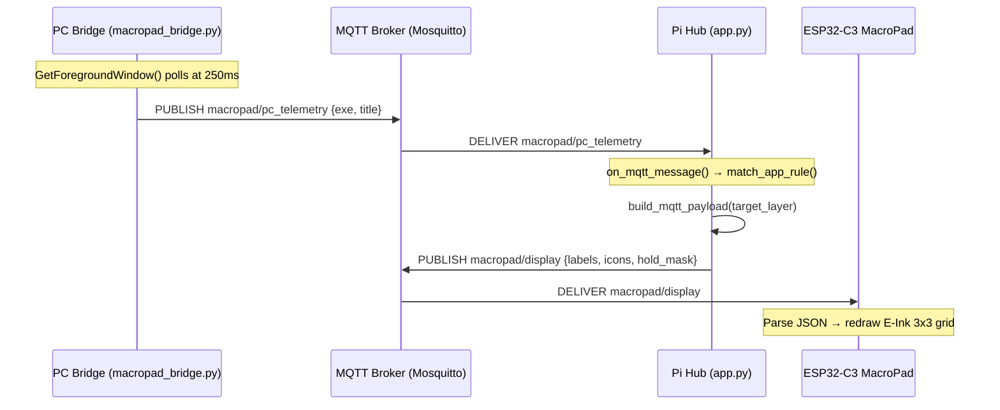

# MacroPad Ecosystem — Staff-Level Architectural Code Review

---

## 1) Key Vulnerabilities & Bottlenecks

### 1.1 Critical Path: Keystroke → E-Ink Display Roundtrip

The full critical path is:



**Worst-case latency:** 250ms (poll) + ~5ms (MQTT QoS 0) + ~15ms (Pi match + build) + ~5ms (MQTT QoS 0) + ~800ms (E-Ink partial refresh) ≈ **~1.1 seconds.**

> [!WARNING]
> **Race Condition #1: Dual-path layer switch.** When Auto-App Mode is active, *both* the PC Bridge and the Pi Hub can independently publish to `macropad/display` for the same focus change event:
> - The **PC Bridge** calls `apply_layer_via_hub()` at [macropad_bridge.py L2107-2113](file:///c:/Users/Uzzo/Desktop/MACROPAD/pc_app/macropad_bridge.py#L2107-L2113), which POSTs to the Pi's `/api/layers/{id}/apply` endpoint, which publishes to `macropad/display`.
> - The **Pi Hub** receives the `macropad/pc_telemetry` message in `on_mqtt_message()` at [app.py L559-568](file:///c:/Users/Uzzo/Desktop/MACROPAD/pi_app/app.py#L559-L568), and *also* publishes to `macropad/display`.
>
> These two publishes are unsynchronized: the Pi processes `pc_telemetry` on the MQTT thread while the PC's HTTP POST is being handled by FastAPI on a different thread, both racing to push different payloads. The ESP32 will render whichever arrives last, causing **E-Ink flicker** (two full redraws within milliseconds).

> [!WARNING]
> **Race Condition #2: Blocking HTTP inside MQTT thread.** The PC Bridge's `apply_layer_via_hub()` at [L2106-2113](file:///c:/Users/Uzzo/Desktop/MACROPAD/pc_app/macropad_bridge.py#L2106-L2113) makes a *synchronous* `urllib.request.urlopen()` call to the Pi Hub from the `start_window_watcher()` thread. If the Pi Hub is slow to respond (>1.5s timeout), the window watcher stalls and misses focus transitions. During this time, the 250ms poll loop is blocked. Meanwhile, the Pi Hub's MQTT thread processes the same event and acts on it independently.

> [!CAUTION]
> **Race Condition #3: `synced_app_rules` cross-thread mutation.** The dict `synced_app_rules` at [L446-451](file:///c:/Users/Uzzo/Desktop/MACROPAD/pc_app/macropad_bridge.py#L446-L451) is read by the window watcher thread at [L2074](file:///c:/Users/Uzzo/Desktop/MACROPAD/pc_app/macropad_bridge.py#L2074) and written by the MQTT thread's `sync_config_from_hub()` at [L453-469](file:///c:/Users/Uzzo/Desktop/MACROPAD/pc_app/macropad_bridge.py#L453-L469) without any lock. Python's GIL prevents tearing of individual reference assignments, but replacing sub-keys in a dict from one thread while another iterates `.get("rules")` can yield `None` mid-iteration if the entire dict is reassigned between the existence check and the value read.

### 1.2 Data Corruption: `layers_store.json`

> [!CAUTION]
> **Non-atomic file writes.** `LayerManager.save()` at [layer_manager.py L462-478](file:///c:/Users/Uzzo/Desktop/MACROPAD/pi_app/layer_manager.py#L462-L478) opens the file with `open(..., "w")`, which **truncates** the file to 0 bytes before writing. If the Raspberry Pi loses power during `json.dump()`, the file will contain a partial (invalid) JSON payload. On next boot, `LayerManager.load()` will hit the `except` branch at [L456](file:///c:/Users/Uzzo/Desktop/MACROPAD/pi_app/layer_manager.py#L456) and fall back to defaults, **erasing all user-customized layers, radial menus, and app rules.**

### 1.3 Blocking I/O in the Pi Hub's asyncio Event Loop

> [!WARNING]
> **Synchronous SQLite writes on the MQTT background thread.** `log_battery_to_db()` at [app.py L61-74](file:///c:/Users/Uzzo/Desktop/MACROPAD/pi_app/app.py#L61-L74) performs a blocking `sqlite3.connect()` + `INSERT` + `commit()` with a 2-second timeout on every heartbeat. This runs on Paho MQTT's internal network loop thread, which means **no other MQTT messages can be processed for the duration of each SQLite write**. On an SD-card-backed Pi with write amplification or fsync delays, this can reach hundreds of milliseconds per write.
>
> Additionally, `get_battery_history()` at [L754-785](file:///c:/Users/Uzzo/Desktop/MACROPAD/pi_app/app.py#L754-L785) runs a synchronous `sqlite3.connect()` + `SELECT` + `fetchall()` directly inside a FastAPI `async def` handler. This blocks the single-threaded uvicorn event loop for the entire query duration, stalling all WebSocket broadcasts and HTTP requests.

> [!WARNING]
> **Synchronous `urllib.request` inside `async def` handlers.** The `toggle_macropad_stay_awake()` endpoint at [app.py L657-669](file:///c:/Users/Uzzo/Desktop/MACROPAD/pi_app/app.py#L657-L669) uses blocking `urllib.request.urlopen()` inside an `async def`, blocking the asyncio event loop for up to 2 seconds. Same issue in `ensure_macropad_stay_awake()` at [L580-594](file:///c:/Users/Uzzo/Desktop/MACROPAD/pi_app/app.py#L580-L594), which runs on the `liveness_watchdog` background thread — less harmful but still a resource concern.

---

## 2) Concurrency & Network Architecture Review

### 2.1 Pi Hub Threading Model

The Pi Hub has **three concurrent execution contexts** with no synchronization:

| Context | Thread | Shared State Modified |
|---|---|---|
| Paho MQTT `loop_start()` network thread | MQTT callbacks | `device_state`, `benchmark_state`, SQLite DB |
| `liveness_watchdog()` daemon thread | Background thread | `device_state`, HTTP to ESP32 |
| uvicorn asyncio event loop | Main thread | `ws_clients`, `device_state` (via REST endpoints) |

**Problem:** `device_state` is a plain `dict` mutated by all three contexts without a `threading.Lock`. While CPython's GIL prevents data corruption at the bytecode level, interleaved writes from the MQTT thread and the liveness watchdog can produce logically inconsistent states (e.g., `vbat` from heartbeat N and `batt_pct` from heartbeat N-1).

**Problem:** `ws_clients` (a plain `list`) is iterated in `broadcast_state()` at [app.py L203-214](file:///c:/Users/Uzzo/Desktop/MACROPAD/pi_app/app.py#L203-L214) from the MQTT thread via `asyncio.run_coroutine_threadsafe()`, while being mutated (`.append()` / `.remove()`) from the asyncio thread in the WebSocket handler at [L1006/L1018-1022](file:///c:/Users/Uzzo/Desktop/MACROPAD/pi_app/app.py#L1006-L1022). Iterating `list(ws_clients)` copies the reference list, but a `remove()` between the copy and the `send_text()` can cause the coroutine to fail with a closed WebSocket — the `except Exception: pass` at [L200-201](file:///c:/Users/Uzzo/Desktop/MACROPAD/pi_app/app.py#L200-L201) silently swallows this, but it wastes event loop coroutine slots.

### 2.2 PC Bridge Threading Model

The PC Bridge has **five** concurrent threads:

| Thread | Purpose | Blocking I/O |
|---|---|---|
| Main thread | `mqtt_client.loop_forever()` | MQTT network loop |
| `start_window_watcher` | `GetForegroundWindow` poll every 250ms | `urllib.request` to Pi Hub |
| `start_discord_rpc` | Reconnection supervisor | `requests.post()` to Discord API |
| Discord RPC `_listen_loop` | `PeekNamedPipe` + `ReadFile` poll at 20ms | Win32 pipe I/O |
| `pynput.GlobalHotKeys` | Low-level keyboard hook | Windows message pump |

**Problem:** The MQTT `on_message` handler at [L1639-1964](file:///c:/Users/Uzzo/Desktop/MACROPAD/pc_app/macropad_bridge.py#L1639-L1964) calls functions like `toggle_microphone_mute()` → `trigger_discord_mute_hotkey()` which contain **cumulative `time.sleep()` totals of ~280ms** (20ms×6 + 60ms + 50ms) at [L1394-1413](file:///c:/Users/Uzzo/Desktop/MACROPAD/pc_app/macropad_bridge.py#L1394-L1413). While this executes, Paho's network loop thread blocks, meaning **no other MQTT messages can be dispatched** for a quarter of a second — including encoder scrolls, key releases, or urgent layer changes arriving during that window.

### 2.3 UDP to Fusion 360 Add-In: Reliability Analysis

`send_fusion_addin_command()` at [L404-421](file:///c:/Users/Uzzo/Desktop/MACROPAD/pc_app/macropad_bridge.py#L404-L421) uses UDP with a **45ms timeout** for the acknowledgement. This is tight but acceptable on loopback. However:

- **No retry logic.** If Fusion's main UI thread is blocked by a modal dialog (e.g., save dialog, crash reporter), the custom event won't fire, the UDP listener will receive the packet but `fireCustomEvent` will queue — the ack *will* be sent (since it's sent before `fireCustomEvent`), but the command may execute after a long delay.
- **Single-socket-per-call pattern.** Each call creates, sends, recvs, and closes a UDP socket at [L412-421](file:///c:/Users/Uzzo/Desktop/MACROPAD/pc_app/macropad_bridge.py#L412-L421). This is fine for localhost but wasteful — ~0.5ms of syscall overhead per call.
- **No sequence numbering.** If the same command is sent twice rapidly (e.g., user double-taps), both will execute. For idempotent commands this is benign, but for `move` or `extrude` it could be confusing.

### 2.4 Discord IPC: `PeekNamedPipe` Polling Cost

The `_listen_loop` at [discord_rpc.py L431-527](file:///c:/Users/Uzzo/Desktop/MACROPAD/pc_app/discord_rpc.py#L431-L527) polls `PeekNamedPipe` every 20ms. This is **50 syscalls/second** — negligible CPU but it means voice mute state changes have up to 20ms of latency, which is excellent. However:

- **`ReadFile` and `WriteFile` share the same pipe handle without overlapped I/O.** The `_send_lock` at [L149-150](file:///c:/Users/Uzzo/Desktop/MACROPAD/pc_app/discord_rpc.py#L149-L150) protects `WriteFile`, but `ReadFile` in `_read_raw()` at [L152-174](file:///c:/Users/Uzzo/Desktop/MACROPAD/pc_app/discord_rpc.py#L152-L174) doesn't hold the lock. If `_listen_loop` calls `_read_raw()` while a `set_mute()` call from the MQTT thread calls `_send_raw()` → `WriteFile`, the non-overlapped pipe can interleave read and write buffer operations. In practice, the GIL serializes these, but the handle state is OS-level — **if the GIL is released during a `ctypes` call** (which happens for `WriteFile`/`ReadFile` since they're foreign function calls), a true race is possible.

---

## 3) Windows API & OS Integration Review

### 3.1 Focus Detection: `GetForegroundWindow` Polling

The current implementation at [L226-255](file:///c:/Users/Uzzo/Desktop/MACROPAD/pc_app/macropad_bridge.py#L226-L255) polls every 250ms. This has three known failure modes:

**Failure Mode 1: UWP Apps (`ApplicationFrameHost`)**
The `IGNORED_TRANSIENT_EXES` set at [L1969-1972](file:///c:/Users/Uzzo/Desktop/MACROPAD/pc_app/macropad_bridge.py#L1969-L1972) correctly filters `applicationframehost.exe`, but this means **all UWP apps are invisible** (Calculator, Photos, Settings, Microsoft Store, Xbox Game Bar). The code should resolve the actual child process via `UIA` or `dwm` APIs rather than ignoring the frame host entirely.

**Failure Mode 2: Transient Popups & Alt-Tab**
When a user Alt-Tabs, `SearchHost.exe` briefly becomes the foreground window. The ignore list catches this, but:
- `shellexperiencehost.exe` (Start Menu) is ignored, meaning the layer stays on the previous app — good.
- However, `msedge.exe` popups (e.g., "Save As" dialog, Credential Manager) register as `msedge.exe` foreground, which would incorrectly trigger an app-rule match if Edge has a rule.

**Failure Mode 3: UIPI Elevation Boundary**
`OpenProcess(PROCESS_QUERY_LIMITED_INFORMATION)` at [L244](file:///c:/Users/Uzzo/Desktop/MACROPAD/pc_app/macropad_bridge.py#L244) fails silently when the foreground window belongs to an elevated (Admin) process and the bridge is running as a standard user. The function returns `("", "")`, which passes through the `IGNORED_TRANSIENT_EXES` check (since `""` is not in the set) and reaches `match_app_rule("", "")` which returns `None` — this triggers the Universal App overlay for an invisible app. The correct behavior should be to skip this poll iteration entirely.

### 3.2 Input Injection: `SendInput` / `keybd_event`

**Mixed API usage:** The codebase uses both `keybd_event` (at [L265-277](file:///c:/Users/Uzzo/Desktop/MACROPAD/pc_app/macropad_bridge.py#L265-L277)) and `SendInput` (at [L176-182](file:///c:/Users/Uzzo/Desktop/MACROPAD/pc_app/macropad_bridge.py#L176-L182)). `keybd_event` is a legacy wrapper that internally calls `SendInput`, adding overhead and potential inconsistency. More critically:

- `keybd_event` does not support the `KEYEVENTF_SCANCODE` flag correctly on some keyboard layouts. The Discord mute hotkey at [L1394-1413](file:///c:/Users/Uzzo/Desktop/MACROPAD/pc_app/macropad_bridge.py#L1394-L1413) correctly uses `SendInput` with scan codes, but `send_hotkey_combo()` at [L349-373](file:///c:/Users/Uzzo/Desktop/MACROPAD/pc_app/macropad_bridge.py#L349-L373) uses `keybd_event` — games and apps that use DirectInput (like Fortnite) may not receive these keystrokes since they filter for hardware scan codes.

- **UIPI blocks `SendInput` to elevated windows.** If AutoCAD or Fusion 360 runs as Admin, all keystroke injection from the non-elevated bridge will be silently dropped. There is no detection or warning for this case.

### 3.3 `ensure_default_desktop()` Concern

The call to `OpenDesktopW("Default") → SetThreadDesktop()` at [L216-224](file:///c:/Users/Uzzo/Desktop/MACROPAD/pc_app/macropad_bridge.py#L216-L224) runs on every `get_foreground_window_info()` invocation (50+ times/second across all callers). While the overhead is minimal (~0.02ms), `SetThreadDesktop` has thread-affinity side effects: it changes the calling thread's desktop association, which can affect window enumeration and message dispatch. Since this is called from both the window watcher thread and the MQTT handler thread, the two threads may briefly see different desktop associations.

---

## 4) Actionable Refactoring Steps

### Step 1: Eliminate the Dual-Path Layer-Switch Race

**Problem:** Both the PC Bridge and Pi Hub independently push `macropad/display` on the same focus-change event.

**Solution:** Make the PC Bridge the **sole authority** for auto-app layer switching. Remove the auto-switch logic from the Pi Hub's `macropad/pc_telemetry` handler, and have it only update dashboard state:

```python
# pi_app/app.py — Replace lines 547-571
# In on_mqtt_message(), the pc_telemetry handler:

    # 5. PC BRIDGE TELEMETRY & FOCUSED WINDOW STREAM
    elif topic == "macropad/pc_telemetry":
        exe = payload.get("exe", "")
        title = payload.get("title", "")
        device_state["pc_bridge_online"] = True
        device_state["pc_bridge_last_seen"] = time.time()
        device_state["focused_app_exe"] = exe
        device_state["focused_app_title"] = title
        # Display-only: update dashboard matched rule label
        rule = layer_manager.match_app_rule(exe, title)
        if rule:
            target_l = int(rule.get("target_layer") or rule.get("layer") or 1)
            device_state["active_app_rule"] = f"{rule.get('name')} -> L{target_l}"
        else:
            device_state["active_app_rule"] = payload.get("matched_rule", "")
        # DO NOT publish to macropad/display here — the PC Bridge
        # owns auto-app layer switching via apply_layer_via_hub()
        broadcast_state()
```

### Step 2: Atomic `layers_store.json` Writes (Crash-Safe)

**Problem:** Truncation-then-write risks data loss on power failure.

**Solution:** Write to a temporary file, then atomically rename:

```python
# pi_app/layer_manager.py — Replace the save() method (lines 462-478)

    def save(self):
        try:
            self.app_rules = _normalize_rules(self.app_rules)
            custom_icons = {k: v for k, v in self.icons_library.items()
                           if v.get("custom", False)}
            data = {
                "layers": self.layers,
                "custom_icons": custom_icons,
                "app_rules": self.app_rules,
                "auto_app_mode": self.auto_app_mode,
                "untracked_behavior": self.untracked_behavior,
                "fallback_layer": self.fallback_layer,
                "top_modifiers": self.top_modifiers
            }
            # Write to temp file first, then atomically replace
            tmp_path = self.store_path + ".tmp"
            with open(tmp_path, "w", encoding="utf-8") as f:
                json.dump(data, f, indent=2)
                f.flush()
                os.fsync(f.fileno())  # Force flush to SD card
            os.replace(tmp_path, self.store_path)  # Atomic on POSIX
        except Exception as e:
            print(f"[LayerManager] Error saving store: {e}")
```

### Step 3: Move SQLite Writes Off the MQTT Thread

**Problem:** Blocking `sqlite3.connect()` + `INSERT` stalls MQTT message processing.

**Solution:** Use a dedicated writer thread with a `queue.Queue`:

```python
# pi_app/app.py — Add near the top, after init_db() at line 59

import queue

_battery_log_queue = queue.Queue(maxsize=500)

def _battery_writer_loop():
    """Dedicated background thread that drains battery telemetry
    to SQLite without blocking the MQTT or asyncio threads."""
    conn = sqlite3.connect(DB_PATH, timeout=5.0)
    conn.execute("PRAGMA journal_mode=WAL")  # WAL = concurrent reads
    while True:
        batch = []
        # Block until at least one item, then drain up to 50
        try:
            batch.append(_battery_log_queue.get(timeout=10))
        except queue.Empty:
            continue
        while len(batch) < 50:
            try:
                batch.append(_battery_log_queue.get_nowait())
            except queue.Empty:
                break
        try:
            c = conn.cursor()
            c.executemany('''
                INSERT INTO battery_logs (timestamp, time_str, vbat, batt_pct, rssi, state)
                VALUES (?, ?, ?, ?, ?, ?)
            ''', batch)
            conn.commit()
        except Exception:
            pass

_battery_writer_thread = threading.Thread(target=_battery_writer_loop, daemon=True)
_battery_writer_thread.start()


def log_battery_to_db(vbat: float, batt_pct: int, rssi: int, state: str):
    now = time.time()
    time_str = datetime.datetime.now().strftime("%Y-%m-%d %H:%M:%S")
    try:
        _battery_log_queue.put_nowait((now, time_str, vbat, batt_pct, rssi, state))
    except queue.Full:
        pass  # Drop oldest telemetry under extreme load
```

And convert the battery history endpoint to use `asyncio.to_thread()`:

```python
# pi_app/app.py — Replace get_battery_history (lines 754-785)

@app.get("/api/battery/history")
async def get_battery_history(hours: int = 48):
    return await asyncio.to_thread(_sync_get_battery_history, hours)

def _sync_get_battery_history(hours: int):
    try:
        since = time.time() - (hours * 3600)
        conn = sqlite3.connect(DB_PATH, timeout=2.0)
        c = conn.cursor()
        c.execute('''
            SELECT time_str, vbat, batt_pct, rssi, state, timestamp
            FROM battery_logs WHERE timestamp >= ?
            ORDER BY timestamp ASC
        ''', (since,))
        rows = c.fetchall()
        conn.close()
        step = max(1, len(rows) // 300)
        return [
            {"time": r[0], "vbat": round(r[1], 2), "batt_pct": r[2],
             "rssi": r[3], "state": r[4], "ts": r[5]}
            for r in rows[::step]
        ]
    except Exception:
        return []
```

### Step 4: Replace `urllib.request` with Non-Blocking HTTP in `async def` Handlers

```python
# pi_app/app.py — Replace toggle_macropad_stay_awake (lines 657-669)

import aiohttp  # Add to requirements.txt

@app.post("/api/macropad/toggle_stay_awake")
async def toggle_macropad_stay_awake():
    try:
        async with aiohttp.ClientSession() as session:
            async with session.post(
                "http://192.168.1.58/api/toggle_stay_awake",
                headers={"User-Agent": "MacroPadHub"},
                timeout=aiohttp.ClientTimeout(total=2.0)
            ) as resp:
                res_str = (await resp.text()).strip()
                device_state["stay_awake"] = (res_str == "ON")
                add_log_entry("SYSTEM", "POWER",
                              f"MacroPad Stay Awake toggled -> {res_str}")
                broadcast_state()
                return {"status": "ok", "stay_awake": device_state["stay_awake"]}
    except Exception as e:
        return {"status": "error", "message": str(e)}
```

### Step 5: Fix UWP App Resolution via `ApplicationFrameHost` Child Process

**Problem:** All UWP apps are invisible because `applicationframehost.exe` is in the ignore list.

**Solution:** When the foreground process is `ApplicationFrameHost`, resolve the actual hosted app:

```python
# pc_app/macropad_bridge.py — Add this function after get_foreground_window_info()

def _resolve_uwp_child_exe(hwnd) -> str:
    """Resolves the actual UWP app exe when ApplicationFrameHost owns the window.
    Uses FindWindowEx to locate the 'Windows.UI.Core.CoreWindow' child,
    then gets that child's owning process."""
    try:
        # Find the CoreWindow child inside the ApplicationFrameHost
        core_hwnd = ctypes.windll.user32.FindWindowExW(hwnd, 0,
                        "Windows.UI.Core.CoreWindow", None)
        if not core_hwnd:
            return ""
        pid = ctypes.c_ulong(0)
        ctypes.windll.user32.GetWindowThreadProcessId(core_hwnd, ctypes.byref(pid))
        if not pid.value:
            return ""
        hproc = ctypes.windll.kernel32.OpenProcess(
            PROCESS_QUERY_LIMITED_INFORMATION, False, pid.value)
        if not hproc:
            return ""
        try:
            path_buf = ctypes.create_unicode_buffer(512)
            sz = ctypes.c_ulong(512)
            if ctypes.windll.kernel32.QueryFullProcessImageNameW(
                    hproc, 0, path_buf, ctypes.byref(sz)):
                return os.path.basename(path_buf.value).lower()
        finally:
            ctypes.windll.kernel32.CloseHandle(hproc)
    except Exception:
        pass
    return ""
```

Then modify `get_foreground_window_info()` to use it:

```python
# pc_app/macropad_bridge.py — In get_foreground_window_info(), after line 250:
#   exe_name = os.path.basename(path_buf.value).lower()
# Add:

        # Resolve actual UWP app if this is ApplicationFrameHost
        if exe_name == "applicationframehost.exe":
            real_exe = _resolve_uwp_child_exe(hwnd)
            if real_exe and real_exe != "applicationframehost.exe":
                exe_name = real_exe
```

And **remove** `"applicationframehost.exe"` from `IGNORED_TRANSIENT_EXES`:

```python
# pc_app/macropad_bridge.py — Line 1971, remove "applicationframehost.exe"
IGNORED_TRANSIENT_EXES = {
    "pythonw.exe", "python.exe", "searchhost.exe", "shellexperiencehost.exe",
    "startmenuexperiencehost.exe", "lockapp.exe"
}
```

### Step 6: Add a Thread Lock for `synced_app_rules` Cross-Thread Access

```python
# pc_app/macropad_bridge.py — Add at module level (after line 452)

import threading
_config_lock = threading.Lock()
```

Then wrap all reads and writes:

```python
# In sync_config_from_hub() (lines 453-469):
def sync_config_from_hub():
    global synced_layers_store, synced_icons_library, synced_app_rules
    try:
        import urllib.request
        url = f"http://{MQTT_BROKER}:5000/api/layers"
        with urllib.request.urlopen(url, timeout=2.5) as resp:
            data = json.loads(resp.read().decode("utf-8"))
            with _config_lock:
                if "layers" in data:
                    synced_layers_store = data["layers"]
                if "icons" in data:
                    synced_icons_library = data["icons"]
                if "app_rules_config" in data:
                    synced_app_rules = data["app_rules_config"]
            # ... logging ...
    except Exception as e:
        # ... logging ...
        pass

# In match_app_rule() (lines 2068-2090) and start_window_watcher():
# Wrap the rules access:
    with _config_lock:
        rules_list = list(synced_app_rules.get("rules")
                          or synced_app_rules.get("app_rules") or [])
        auto_mode = synced_app_rules.get("auto_app_mode", False)
```

### Step 7: Protect Discord IPC Pipe Handle from Concurrent Read/Write

```python
# pc_app/discord_rpc.py — Change _read_raw to acquire _send_lock

    def _read_raw(self):
        if not self.is_connected or self.handle in (INVALID_HANDLE_VALUE, 0):
            return None, None
        with self._send_lock:  # <-- Serialize with writes
            hdr = ctypes.create_string_buffer(8)
            read_bytes = wintypes.DWORD()
            res = k32.ReadFile(self.handle, hdr, 8,
                               ctypes.byref(read_bytes), None)
            if not res or read_bytes.value < 8:
                return None, None
            op, length = struct.unpack("<II", hdr.raw)
            data = ctypes.create_string_buffer(length)
            total = 0
            while total < length:
                chunk = ctypes.create_string_buffer(length - total)
                res = k32.ReadFile(self.handle, chunk, length - total,
                                   ctypes.byref(read_bytes), None)
                if not res or read_bytes.value == 0:
                    break
                data.raw = (data.raw[:total]
                            + chunk.raw[:read_bytes.value]
                            + data.raw[total + read_bytes.value:])
                total += read_bytes.value
        try:
            return op, json.loads(data.raw[:length].decode("utf-8"))
        except Exception as e:
            logger.warning(f"Error decoding Discord message: {e}")
            return None, None
```

### Step 8: Reduce MQTT Thread Blocking from `time.sleep()` in Key Handlers

**Problem:** `send_hotkey_combo()` and `trigger_discord_mute_hotkey()` contain ~280ms of cumulative `time.sleep()` calls, blocking Paho's message dispatch.

**Solution:** Offload keystroke injection to a dedicated worker thread:

```python
# pc_app/macropad_bridge.py — Add near module level

import queue
_keystroke_queue = queue.Queue(maxsize=64)

def _keystroke_worker():
    """Drains keystroke injection jobs off the MQTT thread."""
    while True:
        fn, args, kwargs = _keystroke_queue.get()
        try:
            fn(*args, **kwargs)
        except Exception as e:
            logger.error(f"Keystroke worker error: {e}")

threading.Thread(target=_keystroke_worker, daemon=True).start()

def enqueue_keystroke(fn, *args, **kwargs):
    """Non-blocking dispatch of keystroke injection."""
    try:
        _keystroke_queue.put_nowait((fn, args, kwargs))
    except queue.Full:
        logger.warning("Keystroke queue full, dropping input")
```

Then in `on_message`, replace direct calls like:
```python
# Before:
toggle_microphone_mute()
# After:
enqueue_keystroke(toggle_microphone_mute)
```

---

## 5) Edge Cases Considered

### 5.1 Elevation Mismatch (UIPI)
If AutoCAD or Fusion 360 is running as Administrator and the bridge is not, **all `SendInput` calls will be silently dropped by Windows**. Detection: after `SendInput`, check the return value (it returns the number of events successfully inserted). If 0, log a UIPI warning and surface it on the MacroPad screen.

### 5.2 Discord RPC Token Expiry
The stored OAuth2 token at [discord_rpc.py L251-258](file:///c:/Users/Uzzo/Desktop/MACROPAD/pc_app/discord_rpc.py#L251-L258) has no expiry tracking. If the token expires, `_try_token()` will fail, triggering re-authorization — but this pops up a Discord consent dialog that requires user interaction. If running headless (as a startup service via `pythonw.exe`), this dialog is invisible and the RPC will retry forever every 10 seconds, logging warnings. Store the `expires_in` field from the token exchange response and proactively refresh before expiry.

### 5.3 E-Ink Burn-In from Rapid Auto-App Switching
Alt-Tabbing rapidly between two tracked apps (e.g., Fusion and Discord) at 250ms poll intervals will trigger E-Ink partial refreshes at ~4Hz. E-Ink displays are rated for ~1Hz full refresh and ~3Hz partial refresh. **Debounce** the layer switch with a 500ms settle-before-send: only push `macropad/display` if the same app has been focused for >500ms continuously.

### 5.4 `notification_bridge.py` `processed_ids` Memory Leak
The `processed_ids` set at [notification_bridge.py L26](file:///c:/Users/Uzzo/Desktop/MACROPAD/pc_app/notification_bridge.py#L26) is pruned each poll cycle by intersecting with current notifications at [L93](file:///c:/Users/Uzzo/Desktop/MACROPAD/pc_app/notification_bridge.py#L93). This is correct, but if `get_notifications_async()` raises an exception, the pruning is skipped (the `except` at [L95-96](file:///c:/Users/Uzzo/Desktop/MACROPAD/pc_app/notification_bridge.py#L95-L96) doesn't prune), and the set will grow unbounded. Move the pruning to a `finally` block.

### 5.5 Fusion Add-In: `_name_to_id_cache` Stale After Workspace Change
`_build_command_cache()` at [fusion add-in L115-135](file:///c:/Users/Uzzo/Desktop/MACROPAD/fusion_addin/MacroPadFusionBridge/MacroPadFusionBridge.py#L115-L135) has a guard `if _name_to_id_cache: return` that prevents re-indexing. If the user switches Fusion workspaces (Design → Manufacturing → Simulation), different command definitions become available. The cache should be invalidated on workspace change, or rebuilt lazily with a TTL.

### 5.6 WhatsApp Bridge File I/O Races
`get_whatsapp_status()` at [app.py L706-713](file:///c:/Users/Uzzo/Desktop/MACROPAD/pi_app/app.py#L706-L713) reads `qr_status.json` from disk, while the Node.js WhatsApp Baileys bridge writes to the same file. If the read occurs mid-write, `json.load()` will fail with a decode error and return the error string to the client. Use file locking (`fcntl.flock` on Linux) or read from a temp-then-rename pattern (same as recommended for `layers_store.json`).

### 5.7 `os.system("shutdown ...")` Command Injection
At [macropad_bridge.py L1944](file:///c:/Users/Uzzo/Desktop/MACROPAD/pc_app/macropad_bridge.py#L1944), the `duration` parameter from the MQTT payload is interpolated directly into `os.system()`. While this is an integer from your own device, a compromised MQTT broker or a crafted `macropad/input` message could inject arbitrary shell commands. Use `subprocess.run(["shutdown", "/s", "/t", str(int(duration))], ...)` instead.

### 5.8 `send_mouse_wheel` Signed Integer Overflow
At [macropad_bridge.py L379-380](file:///c:/Users/Uzzo/Desktop/MACROPAD/pc_app/macropad_bridge.py#L379-L380), `delta * 120` is cast to `ctypes.c_ulong` for `mouseData`, but `mouseData` in the `MOUSEINPUT` struct is a **signed** `DWORD`. Negative wheel deltas (scroll down) will be masked by `& 0xFFFFFFFF`. This works in practice because Windows re-interprets the bits as signed, but the struct definition should use `ctypes.c_long` for `mouseData` to match the Win32 `MOUSEINPUT` definition correctly.
